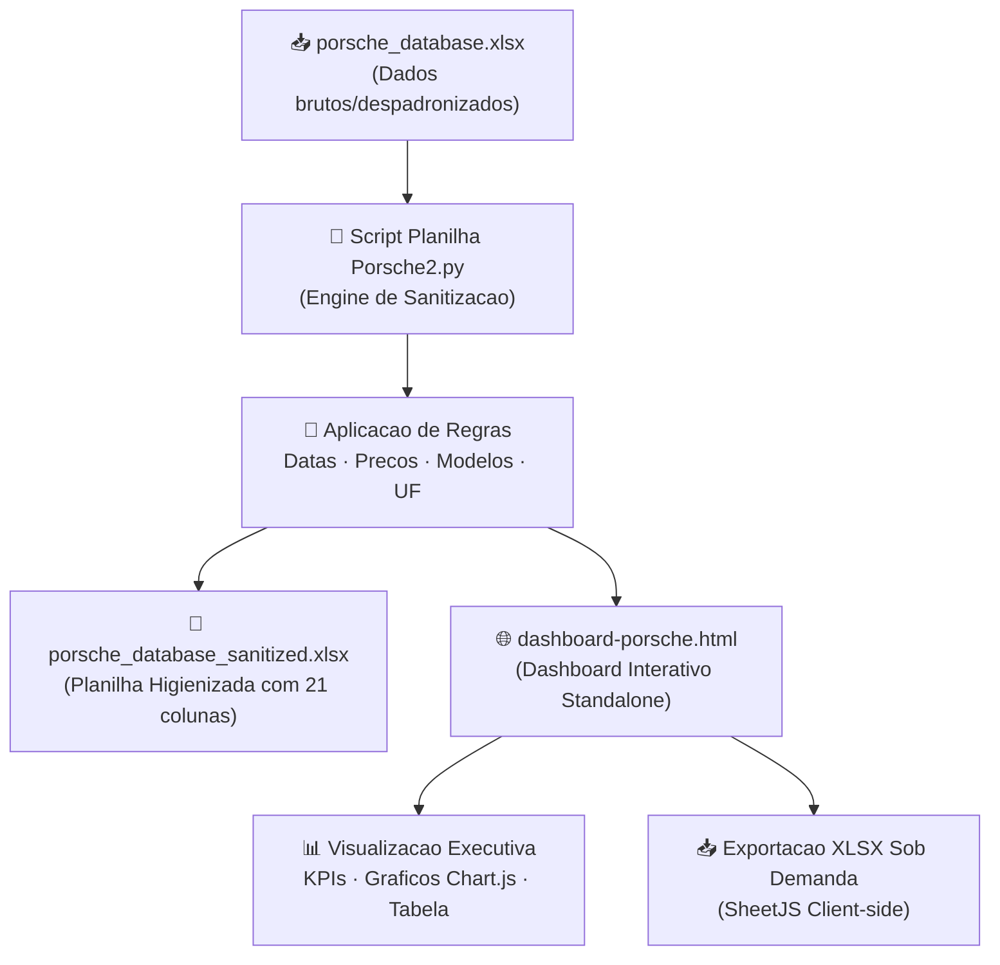

# 🏎️ Dashboard de Vendas e Performance Porsche (HTML & Excel)

<div align="center">


**Dashboard Executivo Interativo de Vendas Porsche em HTML/JS com Pipeline Automatizado de Sanitizacao em Python e Excel**

[📌 Sobre](#-sobre-o-projeto) • [🎯 Objetivos](#-objetivos-do-projeto) • [🧹 Higienizacao](#-regras-de-higienizacao-de-dados) • [📊 Painel HTML](#-recursos-do-dashboard-html) • [🚀 Como Executar](#-como-executar) • [📂 Estrutura](#-estrutura-de-arquivos)

</div>

---

## 📌 Sobre o Projeto

Este projeto foi desenvolvido na trilha **Santander - Excel com IA e Claude (Aceleracao AI Reports com Excel, GPT Agents e Claude Code)** pela **DIO (Digital Innovation One)**.

Ele implementa uma solucao integrada de **Engenharia e Visualizacao de Dados**:
1. **Pipeline de Sanitizacao Automatizado em Python (`Script Planilha Porsche2.py`)**: Le a base bruta `porsche_database.xlsx` com dados despadronizados de vendas, aplica regras estritas de higienizacao e valida calendarizacao, moedas, milhagens, cidades e estados norte-americanos.
2. **Workbook Saneado (`porsche_database_sanitized.xlsx`)**: Estrutura analitica com cada coluna tratada inserida imediatamente apos a coluna fonte, rotulada com sufixo `Sanitized` e celulas invalidas identificadas como `INVALID`.
3. **Dashboard Web Executivo (`dashboard-porsche.html`)**: Interface moderna em tema escuro com identidade visual da Porsche (Preto, Branco, Vermelho Motorsport e Dourado), gerando KPIs em tempo real, graficos interativos via Chart.js, filtros multidimensionais e exportacao instantanea para XLSX via SheetJS.

---

## 🎯 Objetivos do Projeto

<div align="center">

| # | 🎯 Pilar | 📋 Entrega Realizada |
|---|---|---|
| 1 | 🧹 **Saneamento de Dados** | Transformacao de precos textuais/mistos, datas invalidas, milhas e siglas de estados |
| 2 | 📊 **KPIs Executivos (Big Numbers)** | Faturamento total, ticket medio, unidades entregues e modelo lider de vendas |
| 3 | 📈 **Visualizacao Interativa** | Graficos de barras horizontais/verticais e distribuicao de status em doughnut |
| 4 | 🎛️ **Filtros Dinamicos** | Filtros combinados por Modelo, Ano de Fabricacao, Status de Entrega, Pagamento e Busca Livre |
| 5 | 📥 **Exportacao de Dados** | Geracao sob demanda de relatorios Excel (`.xlsx`) com os dados filtrados em tela |

</div>

---

## 🧹 Regras de Higienizacao de Dados (Schema)

Conforme o schema definido em `Prompt Schema Porsche.md`, cada registro foi normalizado:

| Coluna Original | Coluna Sanitizada | Regras Aplicadas |
|---|---|---|
| `sale_date` | `SaleDateSanitized` | Formato ISO `YYYY-MM-DD`. Datas impossiveis (ex.: 30 de fevereiro, 31 de abril) convertidas em `INVALID` |
| `porsche_model` | `PorscheModelSanitized` | Title Case canonico preservando siglas tecnicas (`911 Turbo S`, `718 Cayman GT4 RS`, `E-Hybrid`) |
| `model_year` | `ModelYearSanitized` | 4 digitos inteiros (`1990` a `2035`). Converte extenso (`twenty twenty four` -> `2024`) |
| `sale_price` | `SalesPriceSanitized` | Decimal USD com duas casas (`.2f`). Remove `$`, `USD`, `dollars` e interpreta multiplicadores `k` |
| `vehicle_mileage` | `VehicleMileageSanitized` | Inteiro em milhas. Converte `KM` para milhas ($1\text{ km} \approx 0.621371\text{ mi}$) e zera `new`/`zero miles` |
| `payment_method` | `PayMethodSanitized` | Lista controlada: `Credit Card`, `Wire Transfer`, `Financing`, `Cash`, `Lease`, etc. |
| `city` | `CitySanitized` | Title Case preservando pontuacoes como `St. Louis` |
| `state` | `StateSanitized` | Sigla oficial USPS com 2 letras (`CA`, `NY`, `TX`). Nomes por extenso convertidos |
| `delivery_status` | `DeliveryStatusSanitized` | Lista controlada: `Delivered`, `In Transit`, `Pending`, `Cancelled`, `Shipped`, etc. |

---

## 📊 Recursos do Dashboard HTML

```
┌─────────────────────────────────────────────────────────────────────────────┐
│ 🏎️ PORSCHE INTELLIGENCE | Executive Sales Analytics       [ 📥 EXPORTAR XLSX ] │
├─────────────────────────────────────────────────────────────────────────────┤
│ 💰 FATURAMENTO TOTAL  │ 🚗 UNIDADES VENDIDAS  │ ⚡ MILHAGEM MEDIA │ 🏆 MODELO LIDER │
│   $12,827,800.50     │      100 veiculos     │     11,422 mi     │   911 Turbo S   │
│ Ticket: $128,278.01  │    72% Entregues      │   Media frota     │ $1,880,000.00   │
├─────────────────────────────────────────────────────────────────────────────┤
│ 🎛️ FILTROS DINAMICOS:                                                       │
│ [ Modelo: Todos ]  [ Ano: Todos ]  [ Status: Todos ]  [ Busca: _________ ]   │
├─────────────────────────────────────────────┬───────────────────────────────┤
│ 📊 TOP 10 MODELOS POR FATURAMENTO           │ 🍩 DISTRIBUICAO POR STATUS    │
│ 911 Turbo S     ████████████████ ($1.88M)   │ • Entregues (Delivered): 72%  │
│ Cayenne Turbo   ████████████ ($1.42M)       │ • Em Transito (In Transit): 14%│
│ Taycan Turbo S  ██████████ ($1.15M)         │ • Pendentes (Pending): 8%     │
│ Macan GTS       ████████ ($920k)            │ • Cancelados / Outros: 6%     │
├─────────────────────────────────────────────┴───────────────────────────────┤
│ 📋 TABELA DINAMICA COM BADGES DE STATUS E BUSCA EM TEMPO REAL               │
└─────────────────────────────────────────────────────────────────────────────┘
```

---

## 🗺️ Pipeline de Execucao



---

## 🚀 Como Executar

### 1️⃣ Pre-requisitos

Certifique-se de possuir o Python 3.10+ e as dependencias necessarias:

```bash
pip install openpyxl
```

### 2️⃣ Executar o Script Completo

Execute o script diretamente na pasta do projeto:

```bash
python "Script Planilha Porsche2.py"
```

O comando executara:
* ✅ Higienizacao completa e salvamento de `porsche_database_sanitized.xlsx`
* ✅ Geracao automatica do dashboard atualizado `dashboard-porsche.html`

### 3️⃣ Abrir o Dashboard

Basta dar um duplo clique no arquivo `dashboard-porsche.html` ou abri-lo no seu navegador favorito (Chrome, Edge, Firefox, Safari).

---

## 📂 Estrutura de Arquivos

```
📦 Santander - Excel com IA e Claude/
 ├── 🐍 Script Planilha Porsche2.py      # Engine em Python de saneamento e gerador do HTML
 ├── 📗 porsche_database.xlsx            # Base bruta de dados original
 ├── 📗 porsche_database_sanitized.xlsx  # Planilha corrigida com colunas Sanitized
 ├── 🌐 dashboard-porsche.html           # Dashboard executivo web responsivo
 ├── 📄 Prompt Schema Porsche.md         # Documento com especificacoes e regras de saneamento
 └── 📄 README.md                        # Documentacao profissional do projeto
```

---

## 🛠️ Tecnologias Utilizadas

<div align="center">

| Tecnologia | Finalidade |
|---|---|
|  | Logica de parsing, regex e saneamento de dados |
|  | Leitura, estilizacao e gravacao de planilhas `.xlsx` |
|  | Estrutura semantica do dashboard |
|  | Identidade visual escura Porsche Motorsport |
|  | Reatividade, calculo de KPIs e filtros em tempo real |
|  | Renderizacao dos graficos de faturamento e status |
| -217346?logo=excel&logoColor=white) | Exportacao de dados filtrados para `.xlsx` diretamente no browser |

</div>

---

## 👤 Autor

<div align="center">

**Projeto desenvolvido com 🏎️ foco em excelencia analitica e visual.**

[](https://www.dio.me)
[](https://github.com)
[](https://linkedin.com)

</div>

---

<div align="center">

⭐ **Se este projeto foi util para voce, considere deixar uma estrela no repositorio!** ⭐

`🏎️ Porsche` • `📊 HTML Dashboard` • `🐍 Python` • `📗 Excel Saneado` • `📈 Chart.js` • `🤖 AI Reports`

</div>